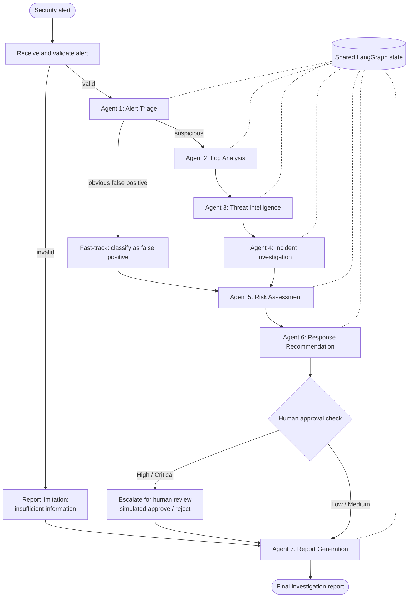

# Autonomous Cybersecurity Incident Investigation: Multi-Agent AI System

A defensive, academic project in which **seven specialised AI agents**, orchestrated with **LangGraph**, investigate security alerts, separate false positives from genuine incidents, score the risk (0-100), recommend *simulated* defensive actions, escalate serious cases to a human, and write a full investigation report.

> **All data in this project is synthetic demonstration data** (documentation-range IP addresses, `.example` domains, fabricated file hashes).
> **No real security action is ever executed.** Every recommendation is simulated and needs human approval.

---

## 1. Problem statement

A company receives thousands of security alerts every day. Most are false positives; a few are real attacks. Analysts waste time on noise and may miss the incidents that matter. This system automates the first investigation steps: it triages alerts, analyses the related logs, checks indicators against threat intelligence, correlates the evidence, scores the risk and prepares a report, so a human analyst only has to review and approve.

## 2. Objectives

- Collect, validate and categorise alerts; identify duplicates and obvious false positives.
- Analyse security logs (failed logins, unusual locations, scans, transfers, DNS beaconing, account changes).
- Compare indicators with a local threat-intelligence dataset, **separating verified from unverified matches**.
- Classify each incident from evidence, calculate a transparent risk score, and recommend defensive actions.
- Escalate High/Critical incidents for (simulated) human approval.
- Run fully **without an API key** (DEMO mode) and use the **Groq** LLM when a key is configured.

## 3. Technologies

| Purpose | Library |
|---|---|
| Multi-agent orchestration | LangGraph (`StateGraph`) |
| LLM | Groq API (official `groq` SDK), JSON mode |
| Data validation | Pydantic v2 |
| Log analysis | Pandas |
| Optional anomaly detection | scikit-learn (`IsolationForest`) |
| User interface | Streamlit |
| Tests | Pytest |
| Environment variables | python-dotenv |

Tested with Python 3.12 and: langgraph 1.2.23, groq 1.7.0, pydantic 2.14.3, pandas 3.0.6, scikit-learn 1.9.1, streamlit 1.67.0, python-dotenv 1.2.4, pytest 9.2.0. `requirements.txt` allows compatible newer versions. Python 3.11 or newer is required.

## 4. Multi-agent architecture

All agents are separate modules in `agents/`. They never call each other: they only read from and write to a **shared LangGraph state** (`graph/state.py`).

| # | Agent (file) | Responsibility |
|---|---|---|
| 1 | **Alert Triage** (`alert_triage.py`) | Validate alerts, categorise them, find duplicates, assign initial severity, filter obvious false positives, link alerts of the same incident. |
| 2 | **Log Analysis** (`log_analyzer.py`) | Analyse logs around the alert: brute force, success after failures, unusual location/hour, impossible travel, denied access, port scans, large transfers, DNS beaconing, account changes, optional ML outliers; extract indicators. |
| 3 | **Threat Intelligence** (`threat_intelligence.py`) | Match IPs, domains and hashes with `threat_intelligence.csv`; explain each match; keep **verified** and **unverified** apart. Never invents results. |
| 4 | **Incident Investigation** (`incident_investigator.py`) | Correlate everything, pick the evidence-weighted classification, describe the attack pattern, decide genuine vs. false positive. |
| 5 | **Risk Assessment** (`risk_assessor.py`) | Score 0-100 with a documented method and assign Low / Medium / High / Critical. |
| 6 | **Response Recommendation** (`response_recommender.py`) | Simulated investigation, containment, monitoring and hardening steps; escalation for High/Critical. |
| 7 | **Report Generation** (`report_generator.py`) | Final report (JSON + TXT), executive summary, simulated human-approval decisions. |

### Workflow (LangGraph)

1. Receive alert -> 2. Triage -> 3. Log analysis -> 4. Threat intelligence -> 5. Investigation -> 6. Risk assessment -> 7. Response recommendation -> 8. Human approval / escalation check -> 9. Report generation -> 10. Display the report.

Conditional routing:

- **Invalid alert** -> skips investigation, reports the limitation (nothing is invented).
- **Obvious false positive** (e.g. authorized scanner, backup job, SIEM test) -> classified immediately, then risk -> response -> report.
- **High or Critical risk** -> escalated for human review before the report.
- **Missing logs or intelligence** -> classified "Insufficient information" with a stated limitation.



## 5. Project structure

```
autonomous_cybersecurity_investigation/
├── agents/                  # the 7 agents (one module each) + LangGraph node functions
│   ├── alert_triage.py
│   ├── log_analyzer.py
│   ├── threat_intelligence.py
│   ├── incident_investigator.py
│   ├── risk_assessor.py
│   ├── response_recommender.py
│   └── report_generator.py
├── graph/
│   ├── state.py             # shared state (TypedDict)
│   └── workflow.py          # StateGraph, conditional routing, helpers
├── models/schemas.py        # Pydantic schemas (inputs, agent outputs, report, LLM outputs)
├── utils/
│   ├── llm.py               # Groq client, JSON validation, DEMO-mode fallback
│   ├── risk_scoring.py      # transparent risk methodology
│   ├── data_loader.py       # CSV loading and validation
│   └── netutils.py          # internal/external IP helper
├── data/                    # SYNTHETIC datasets
│   ├── security_alerts.csv  (19 alerts)
│   ├── security_logs.csv    (277 log events)
│   └── threat_intelligence.csv (14 indicators)
├── reports/                 # exported reports are written here
├── tests/                   # pytest suite (no API key needed)
├── app.py                   # Streamlit dashboard
├── main.py                  # command-line interface
├── requirements.txt, .env.example, .gitignore, pytest.ini
└── README.md
```

## 6. Installation (Windows + VS Code, beginner friendly)

1. Install **Python 3.11 or newer** from <https://www.python.org/downloads/> (tick **"Add python.exe to PATH"** in the installer) and **VS Code** with the *Python* extension.
2. Unzip the project, then in VS Code choose **File -> Open Folder...** and open `autonomous_cybersecurity_investigation`.
3. Open a terminal: **Terminal -> New Terminal** (PowerShell). Check you are in the project root (you should see `app.py` with `dir`).

### Create and activate the virtual environment (PowerShell)

```powershell
python -m venv .venv
.venv\Scripts\activate
```

If PowerShell says *"running scripts is disabled on this system"*, run this once and activate again:

```powershell
Set-ExecutionPolicy -Scope CurrentUser -ExecutionPolicy RemoteSigned
.venv\Scripts\activate
```

Your prompt should now start with `(.venv)`. In VS Code press **Ctrl+Shift+P -> "Python: Select Interpreter"** and choose the `.venv` one.

### Install dependencies

```powershell
pip install -r requirements.txt
```

### Configure environment variables (optional)

The project works **without any key** in DEMO mode. To use the Groq LLM:

```powershell
copy .env.example .env
```

Open `.env` and set:

```
GROQ_API_KEY=your_real_key_from_console.groq.com
GROQ_MODEL=a_model_id_listed_on_https://console.groq.com/docs/models
```

Never share or commit `.env` (it is in `.gitignore`). If the key is missing or still the placeholder, the app silently stays in DEMO mode. If `GROQ_MODEL` is missing, `llama-3.3-70b-versatile` is tried; check Groq's model list in case it has been retired. Any model failure is handled gracefully (see section 9).

## 7. How to run

From the project root, with the virtual environment active:

```powershell
python main.py                       # investigate all alerts, print a summary and the top incident, save reports
python main.py --list                # list alerts
python main.py --alert-id ALR-1003   # investigate one alert and print the full report
python main.py --no-llm              # force DEMO mode
python main.py --no-save             # do not write files to reports\
```

Reports are saved as JSON and TXT in `reports\`.

### Streamlit dashboard

```powershell
streamlit run app.py
```

The browser opens at <http://localhost:8501>. Pages:

- **Dashboard**: total alerts, investigated incidents, false positives, high-risk and critical counts, charts, "Investigate all alerts".
- **Alert Management**: search, filter by severity and category, select an alert and investigate it.
- **Investigation**: agent-by-agent findings (triage, logs, threat intel, investigation, risk breakdown, response, trace), indicators, risk score, classification.
- **Security Logs**: search/filter, **upload your own CSV** (validated: required columns, bad timestamps are reported and dropped).
- **Incident Reports**: view reports, recommended actions, **download JSON and TXT**.
- **Human Approval**: High/Critical incidents with **simulated** Approve / Reject (only records a decision).

### Run the tests

```powershell
pytest -v
```

No API key is needed; the Groq client is mocked.

## 8. Sample input and output

Sample alert (`data/security_alerts.csv`):

```
ALR-1003, 2026-11-18T14:11:00Z, login_after_failures, Critical, 203.0.113.45, ..., jsmith, vpn-gw-01,
"Successful VPN login for jsmith immediately after many failed attempts from the same IP"
```

Result of `python main.py` in DEMO mode (excerpt):

```
Alert      Type                         Classification                 Score  Level     Approval
ALR-1001   failed_login_burst           Brute-force login attempts        75  Critical  PENDING_HUMAN_REVIEW
ALR-1003   login_after_failures         Brute-force login attempts        81  Critical  PENDING_HUMAN_REVIEW
ALR-1005   unusual_login_location       Suspicious login activity         31  Medium    NOT_REQUIRED
ALR-1009   suspicious_account_activity  Suspicious account activity       50  High      PENDING_HUMAN_REVIEW
ALR-1010   malware_detected             Potential malware indicators      75  Critical  PENDING_HUMAN_REVIEW
ALR-1012   after_hours_login            Normal activity                    3  Low       NOT_REQUIRED
ALR-1015   failed_login_burst           False positive                     3  Low       NOT_REQUIRED
ALR-1018   unauthorized_access          Insufficient information          25  Medium    NOT_REQUIRED
```

### Demo scenarios in the data

| Scenario | Alerts |
|---|---|
| Brute force -> account takeover -> data exfiltration (several alerts, one incident, one duplicate) | ALR-1001..1004 |
| Unusual login location / impossible travel (with an *unverified* intel record) | ALR-1005 |
| Suspicious IP, port scan | ALR-1006, 1007 |
| Unauthorized access attempts | ALR-1008 |
| Suspicious account activity (privilege change by a service account) | ALR-1009 |
| Malware hash + DNS beaconing | ALR-1010, 1011 |
| Normal user activity | ALR-1012 |
| False positives (benign failures, scanner, backup, SIEM test, unverified reputation hit) | ALR-1013..1017, 1019 |
| Missing evidence (no matching logs) -> "Insufficient information" | ALR-1018 |

A full report contains: original alert, executive summary, triage, log findings with evidence lines, threat-intel matches (verified / unverified / no record), investigation narrative and numbered evidence, risk breakdown, simulated actions, approval status, limitations and the agent trace.

## 9. LLM integration and DEMO mode

- Key and model come from environment variables (`python-dotenv`); nothing is hardcoded.
- The LLM is used for two things: the **investigation narrative** and the **executive summary**. Requests use JSON mode, a 20 s timeout, and the response is **validated with Pydantic**.
- The LLM **cannot change the classification**. Classification is always produced by evidence-weighted rules. If the LLM disagrees, that is recorded as a limitation.
- Guards against fabrication: cited evidence ids must exist, and IP addresses in the text must appear in the evidence. Otherwise the answer is rejected.
- On any failure (no key, network error, timeout, invalid JSON, schema mismatch) the deterministic rule-based result is used and the report states `Rule-based fallback (LLM error)`. Nothing is invented.
- Without a key the system runs in **DEMO mode**: every feature works with rules only.

## 10. Risk scoring methodology (version 1.1)

Score = sum of seven capped components (maximum 100):

| Component | Max | How points are given |
|---|---|---|
| Alert severity | 20 | Low 3, Medium 8, High 14, Critical 20 (after triage adjustment) |
| Suspicious event volume | 10 | 1+ events 2, 5+ 4, 10+ 6, 20+ 8, 50+ 10 |
| Repeated failed authentication | 10 | Brute-force pattern: by peak failures in 5 min (4 / 6 / 8 / 10); 3+ failures otherwise 2 |
| Threat-intel matches | 20 | Verified: best confidence (High 15, Medium 12, Low 8) + 2 per extra match; unverified only: 3 |
| Unusual login activity | 15 | Impossible travel 8, unusual location 6, off-hours 3 |
| Correlated events | 10 | Linked alerts (1: 2, 2: 3, 3+: 5, 5+: 7) + 3 if 3+ distinct suspicious behaviours |
| Behaviour indicators | 15 | Success after failures 5, large transfer 5, privilege change 15 / account change 10, denied access (3+: 5, 10+: 8), beaconing 8, port scan 4 |

Adjustments (always listed in the report):

- **Minimum scores** for serious indicators: successful login after brute force plus data transfer or verified intel -> 75; verified malicious hash with command-and-control -> 75; verified malicious hash -> 50; privilege change -> 50; large transfer to a verified exfiltration host -> 60; beaconing to a verified C2 domain -> 50.
- **Cap of 20** for incidents classified as *False positive* or *Normal activity*.
- **Floor of 25 (Medium)** for High/Critical alerts that could not be verified because data is missing (missing evidence must not look "safe").

Levels: **0-24 Low, 25-49 Medium, 50-74 High, 75-100 Critical.** High and Critical are escalated for human review.

## 11. Classification (evidence-based)

Categories: Brute-force login attempts, Suspicious login activity, Unauthorized access attempts, Potential malware indicators, Network anomalies, Suspicious account activity, False positive, Normal activity, plus **Insufficient information**. Each finding and each *verified* intel match adds weighted points to a category (the triage category adds a small hint); the highest wins and categories with substantial support are listed as secondary. With no suspicious evidence: Low-severity alerts become *Normal activity*, higher ones *False positive*, and alerts with no matching logs *Insufficient information*. Unverified intel never counts as proof.

## 12. Limitations and future improvements

- Data is small and synthetic; thresholds are illustrative and not tuned on real traffic.
- Country-based travel checks use country codes only (no geo-distance); time zones are treated as UTC.
- The threat-intelligence data is a local CSV; no live feeds. A missing record is **not** proof that an indicator is safe.
- The false-positive allow-list is a constant in `agents/alert_triage.py`.
- The IsolationForest signal is informational and not used for classification.
- Alerts are investigated one at a time; there is no persistent database or case management.
- Approve/Reject is a simulation stored in the browser session only.
- Future work: live threat-intel APIs, MITRE ATT&CK mapping, per-user behaviour baselines, SIEM connectors, persistent storage, real approval workflow with audit trail.

## 13. Troubleshooting

| Problem | Fix |
|---|---|
| `python` not found | Reinstall Python and tick "Add to PATH", or use `py -m venv .venv`. |
| Activation blocked | See the `Set-ExecutionPolicy` command above. |
| `ModuleNotFoundError` | The virtual environment is not active or `pip install -r requirements.txt` was not run. |
| App shows "DEMO mode" although you set a key | Check `.env` is in the project root, the key has no quotes/spaces, then restart `streamlit run app.py`. |
| Report says "Rule-based fallback (LLM error)" | The Groq call failed (key, model name, quota, network). The result is still valid and rule-based. |
